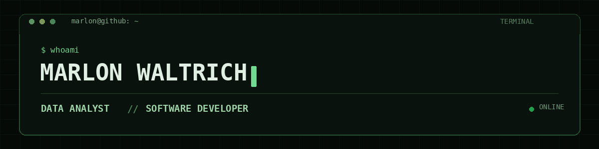

[GitHub](https://github.com/maZero1) · [Instagram](https://www.instagram.com/marlon_santoz11/) · [Email](mailto:tkmarlon594@gmail.com)

---

## About Me

I'm a Data Analyst with a strong interest in technology and software development.

In my professional work, I deal with data and develop solutions using different technologies. I enjoy understanding how systems work, exploring new tools and finding practical solutions to everyday problems.

Outside my current role, I'm particularly interested in backend development, cybersecurity and mobile development.

I also value teamwork, knowledge sharing and taking initiative when working with others.

## Areas of Interest

- **Data & Analytics** — Data analysis, databases and information systems.
- **Backend Development** — APIs, software architecture and server-side development.
- **Cybersecurity** — Information security and system protection.
- **Mobile Development** — Application development and mobile technologies.
- **Problem Solving** — Logical thinking, algorithms and efficient solutions.

## Tech Stack

**Professional Technologies**

**Web Technologies**

## GitHub Languages

## Contact

---

  Learning continuously. Building with purpose.

---

## About Me

I'm a Data Analyst with a strong interest in software engineering, technology and problem-solving.

My professional experience involves working with data and developing solutions using different technologies. Beyond my current role, I'm constantly exploring new areas, particularly backend development, cybersecurity and mobile development.

I value continuous learning, collaboration and taking initiative. I enjoy understanding complex problems, sharing knowledge and contributing to solutions that make a difference.

## Areas of Interest

| Area | Focus |
|---|---|
| Data & Analytics | Data analysis, databases and information systems |
| Backend Development | APIs, software architecture and server-side development |
| Cybersecurity | Information security and system protection |
| Mobile Development | Application development and mobile technologies |
| Problem Solving | Algorithms, logical thinking and efficient solutions |

## Tech Stack

**Languages & Technologies**

  
  
  
  
  
  
  

## GitHub Languages

## Contact

[Instagram](https://www.instagram.com/marlon_santoz11/) · [Discord](https://discord.com/users/maZero1) · [Email](mailto:tkmarlon594@gmail.com)

---

Learning continuously. Building with purpose.

